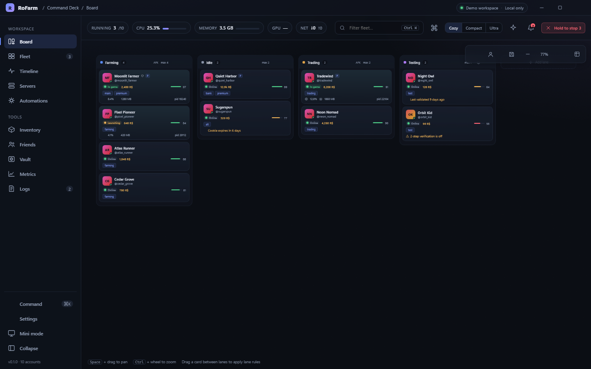
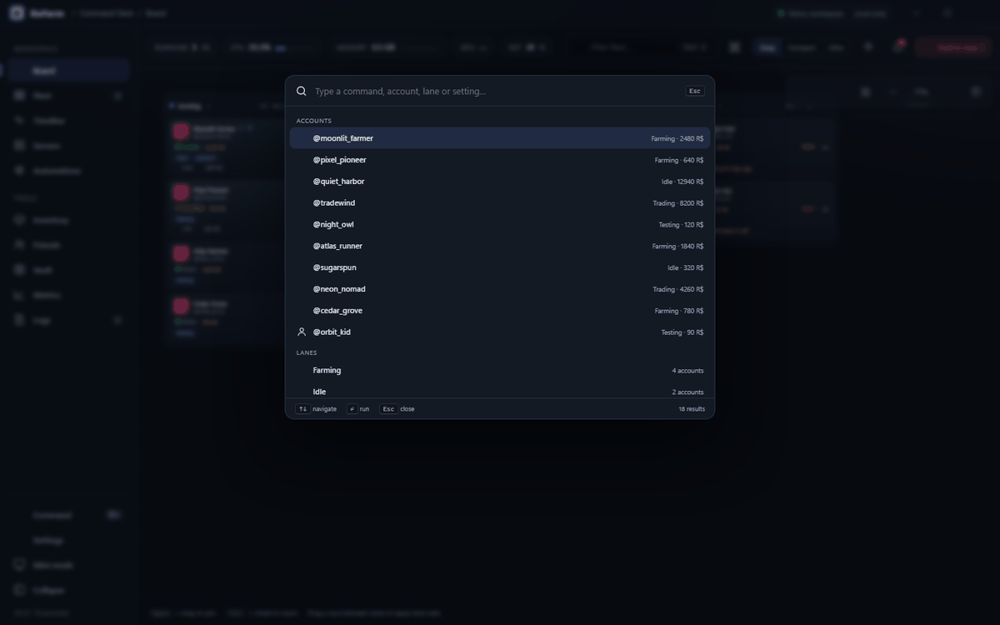
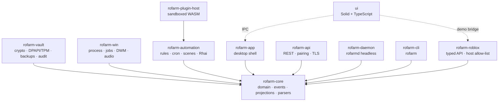

<div align="center">

# RoFarm

**A local-first Windows command deck for running, watching and protecting a fleet of Roblox accounts.**

[](LICENSE)
[](https://github.com/iiicrybalenci/RoFarm/stargazers)
[](https://www.rust-lang.org)
[](#requirements)
[](https://github.com/iiicrybalenci/RoFarm/pulls)



<sub>The Board — four lanes, ten demo accounts, three supervised clients. Demo workspace, no accounts touched.</sub>

</div>

---

## What it is

RoFarm is a desktop application for people who own several Roblox accounts and want to launch,
supervise and secure them from one window. Everything runs on your machine: there is no RoFarm
account, no telemetry, no cloud and no background analytics. The only network traffic is to the
Roblox web API and the notification endpoints you configure yourself.

It is built as a Rust workspace with a Solid + TypeScript front end, an event-sourced core, an
encrypted vault, a headless daemon and a scriptable CLI.

<table>
<tr>
<td width="50%" valign="top">

**Command Deck**

Eleven views, a draggable lane board, command palette, compressed + ultra densities, themeable
panels, keyboard-first navigation, undo/redo and a mini overlay for a second monitor.

</td>
<td width="50%" valign="top">

**Fleet orchestration**

Staggered batch launches, per-client state machines, crash breaker with backoff, auto-rejoin, window
walls, job-object CPU and memory limits, EcoQoS and GPU preferences.

</td>
</tr>
<tr>
<td valign="top">

**Vault v2**

XChaCha20-Poly1305 records, Argon2id calibrated to ~500 ms, per-account data keys wrapped by a master
key, DPAPI/TPM binding, recovery codes, Shamir splits, encrypted `.rofarm` backups, hash-chained audit
log.

</td>
<td valign="top">

**Automation, locally**

Triggers, conditions and actions, cron schedules, scenes, lane rotations, dependency rules, dry-run,
and a sandboxed Rhai console. Nothing is shipped to a server to run.

</td>
</tr>
<tr>
<td valign="top">

**Reach it your way**

Opt-in authenticated local REST API with a remote dashboard, a `rofarmd` headless daemon, and a
`rofarm` CLI with JSON output for scripting.

</td>
<td valign="top">

**Windows-native**

Job objects, DWM thumbnails, WinRT toasts, Task Scheduler autostart with wake timers, `rofarm://`
deep links, taskbar progress, audio sessions and Mica/Acrylic surfaces.

</td>
</tr>
</table>

## Interface

<div align="center">

<br />
<sub><kbd>Ctrl</kbd> + <kbd>K</kbd> opens the command palette — every account, lane and action is one query away.</sub>
</div>

## Requirements

- **Windows 10 1809+ or Windows 11**, x64 or ARM64.
- **Rust 1.85+** (workspace `rust-version`) with the MSVC toolchain for the platform crates.
- **Bun 1.1+** for the Command Deck, or Node 20+ with your package manager of choice.
- **WebView2** for the eventual desktop shell; the board itself runs in any Chromium-based browser.

The libraries, daemon and CLI build on any Rust toolchain; only `rofarm-win` and `rofarm-app` need
Windows.

## Quick start

```powershell
git clone https://github.com/iiicrybalenci/RoFarm.git
cd RoFarm

# Rust workspace: core, vault, roblox, win, automation, plugin host, API, daemon, CLI
cargo check --workspace --exclude rofarm-app --all-targets
cargo test  --workspace --exclude rofarm-app --exclude rofarm-win

# Try the CLI
cargo run -p rofarm-cli -- --help
cargo run -p rofarm-cli -- doctor
```

The Command Deck runs in a browser with a mock bridge and a demo fleet, so you can explore the whole
interface without a vault, an account or a single network call:

```powershell
cd ui
bun install
bun run dev        # http://localhost:1420
```

Production UI builds go through `bun run build`, which type-checks and then bundles each view as a
lazy chunk.

## CLI

`rofarm` is designed to be scriptable: every command accepts `--json` for machine-readable output,
and `--home` (or `ROFARM_HOME`) to point at an isolated data directory.

| Command | What it does |
| --- | --- |
| `rofarm list [--json]` | Accounts with their lane and login state. |
| `rofarm status [--json]` | Fleet totals plus every live client with PID, CPU and memory. |
| `rofarm launch <target> --accounts <ids> [--stagger-ms N] [--profile <id>]` | Batch launch with stagger and an optional saved profile. |
| `rofarm kill <client-id \| all>` | Stop one client or the whole fleet. |
| `rofarm scene list` / `rofarm scene apply <id>` | Inspect and apply saved scenes. |
| `rofarm vault status` / `unlock` / `lock` | Vault state, unlocked with `ROFARM_PASSPHRASE` or a prompt. |
| `rofarm doctor [--json]` | Self-check: event chain, vault state, data directory, telemetry. |
| `rofarm network` | The exact host allow-list RoFarm will contact. |
| `rofarm diagnostics --out bundle.json` | Redacted diagnostics bundle you can review before sharing. |

## Architecture

RoFarm is a single writer with many readers. Every meaningful change is an immutable `DomainEvent`
appended to a hash-chained JSONL log; fleet state is a deterministic projection of that log, which is
what makes undo/redo, run history, recovery and the audit trail share one source of truth.



Three rules keep that structure from drifting:

1. `rofarm-core` depends on no platform or crypto crate, so the domain is testable anywhere.
2. `rofarm-vault` never depends on `rofarm-win`; the Windows key binding is injected as a trait.
3. The UI, CLI, daemon and REST API are composition roots that all call `FleetService`, so a launch
   from the palette takes the same path and emits the same events as `rofarm launch`.

More detail, including the event families and projection model, is in
[docs/ARCHITECTURE.md](docs/ARCHITECTURE.md).

## Repository layout

```
crates/
  rofarm-core/        domain, event log, projections, state machines, parsers, cron
  rofarm-vault/       key hierarchy, crypto, Windows bindings, .rofarm backups, audit chain
  rofarm-roblox/      typed Roblox web client, host allow-list, mock server
  rofarm-win/         Windows platform layer behind a trait
  rofarm-automation/  triggers, conditions, actions, scenes, rotations, Rhai sandbox
  rofarm-plugin-host/ sandboxed WASM plugins with permission manifests
  rofarm-api/         local REST API and the remote dashboard page
  rofarm-daemon/      rofarmd daemon and the rofarm CLI binaries
  rofarm-cli/         shared CLI helpers
  rofarm-app/         desktop shell (placeholder crate)
ui/                   Solid + TypeScript Command Deck
docs/                 architecture, threat model, screenshots
fuzz/                 cargo-fuzz targets for the vault header and import parsers
```

## Security

RoFarm stores Roblox session cookies, so it is built as if the vault file will end up in someone
else's hands:

- **At rest** — vault records are authenticated and versioned, bound to your Windows account with
  DPAPI, optionally sealed to TPM 2.0 and unlocked with Windows Hello / FIDO2.
- **In memory** — secrets are decrypted just-in-time, kept in locked, zeroized buffers, excluded from
  crash dumps and never written to logs.
- **On the wire** — the local API is opt-in, TLS-first, PIN + optional TOTP, per-device pairing
  tokens, an IP allow-list and strict Host/Origin/CSRF checks.
- **On export** — backups are always encrypted with their own passphrase; reveal and export require
  re-authentication; diagnostics are redacted before they leave the app.

What RoFarm explicitly does **not** defend against — a compromised Windows session, administrator
malware, or a debugger attached to an unlocked process — is written down in
[docs/SECURITY.md](docs/SECURITY.md). Read it before trusting RoFarm with accounts.

## Status

This repository is an implementation of the RoFarm product specification, and the gaps are listed
honestly rather than hidden:

- The Rust workspace builds and its test suite passes, apart from a known failing Windows
  command-line quoting test in `rofarm-win`.
- The Command Deck renders against the demo bridge, and the board, palette, theming and density
  controls work. Switching between some panels is still being wired up, and the strict
  `tsc --noEmit` pass reports type errors in a handful of views, so the bundle builds through Vite.
- `rofarm-app` is a placeholder crate. The Tauri shell (tray, hotkeys, updater, deep links) is the
  next milestone.
- The remote dashboard is opt-in and experimental; treat it as a convenience for your own LAN.

## Releases

Builds are cut from signed tags. The release workflow compiles the CLI and daemon on Windows and
attaches a zip to the GitHub release:

```powershell
git tag v0.1.0
git push origin v0.1.0
```

Published binaries live under [Releases](https://github.com/iiicrybalenci/RoFarm/releases), and
changes are recorded in [CHANGELOG.md](CHANGELOG.md).

## Contributing

Bug reports, platform notes and pull requests are welcome. Security issues should go through a
[private advisory](https://github.com/iiicrybalenci/RoFarm/security/advisories/new), never a public
issue.

If RoFarm saves you time, a ⭐ on the repository helps other people find it.

## License

Licensed under the [GNU Affero General Public License v3.0 or later](LICENSE).

## Disclaimer

RoFarm is not affiliated with, endorsed by, or sponsored by Roblox Corporation. Use it only with
accounts you own and in accordance with Roblox's Terms of Use. RoFarm does not read or write Roblox
client memory, inject code, hook the client or attempt to evade detection; it uses documented Windows
APIs and public Roblox web endpoints. Features can break whenever Roblox changes its client or web
API. No warranty, express or implied.
